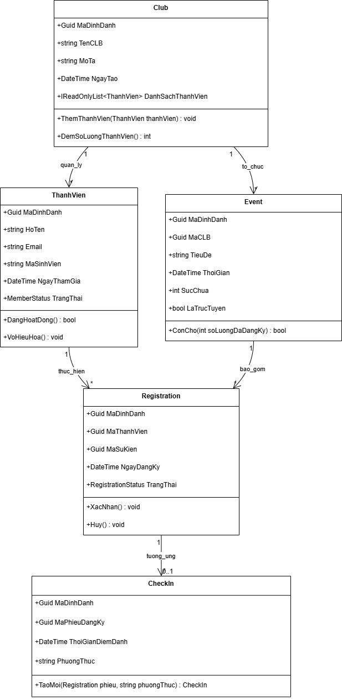
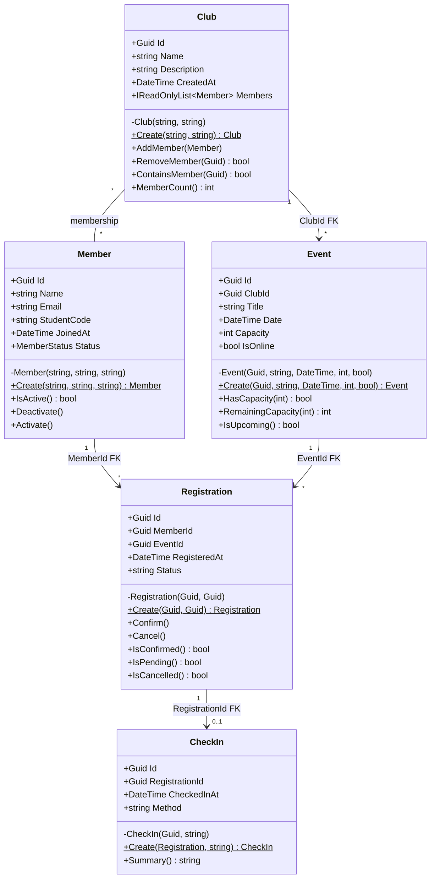

# Sơ đồ lớp — EduHub

Sơ đồ gồm 5 lớp miền chính: `Member`, `Club`, `Event`, `Registration`, `CheckIn`. Các thuộc tính định danh và khoá ngoại được thể hiện rõ; thuộc tính được đóng gói bằng `private set`, khởi tạo thông qua factory `Create(...)`.

## 1. Hình ảnh sơ đồ lớp

## 2. Sơ đồ Mermaid

## 3. Giải thích quan hệ và khoá ngoại

- `Club` — `Member`: quan hệ nhiều-nhiều ở mức mô hình; danh sách thành viên được quản lý qua `Club.AddMember()` và chống trùng theo Id/MSSV.
- `Event.ClubId`: khoá ngoại tham chiếu `Club.Id`; một CLB có thể tổ chức nhiều sự kiện.
- `Registration.MemberId`: khoá ngoại tham chiếu `Member.Id`.
- `Registration.EventId`: khoá ngoại tham chiếu `Event.Id`. `Registration` là lớp nối thành viên với sự kiện.
- `CheckIn.RegistrationId`: khoá ngoại tham chiếu `Registration.Id`; một phiếu có tối đa một bản ghi check-in theo mô hình nghiệp vụ.
